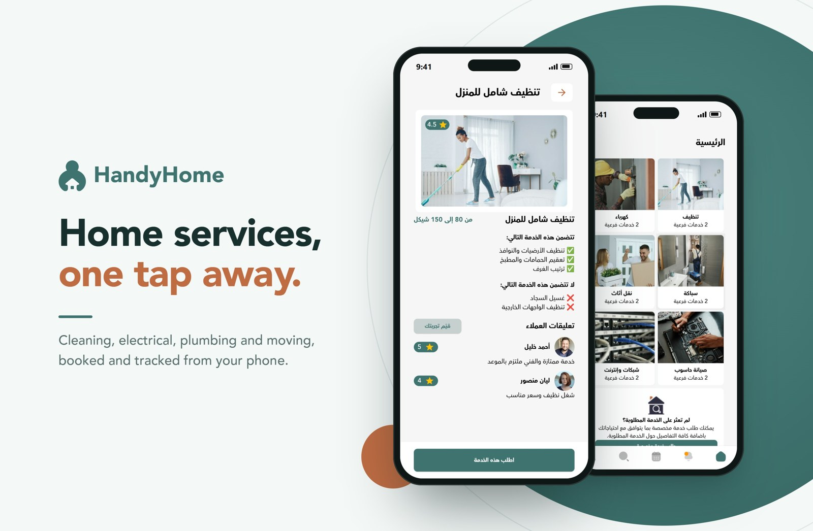
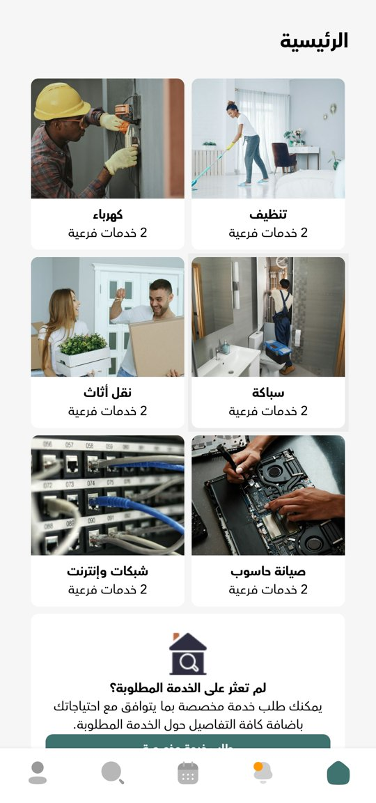
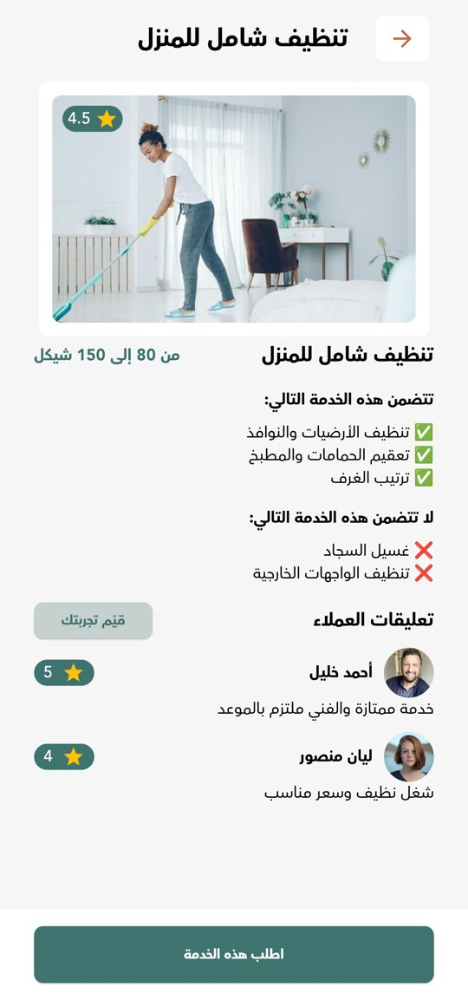
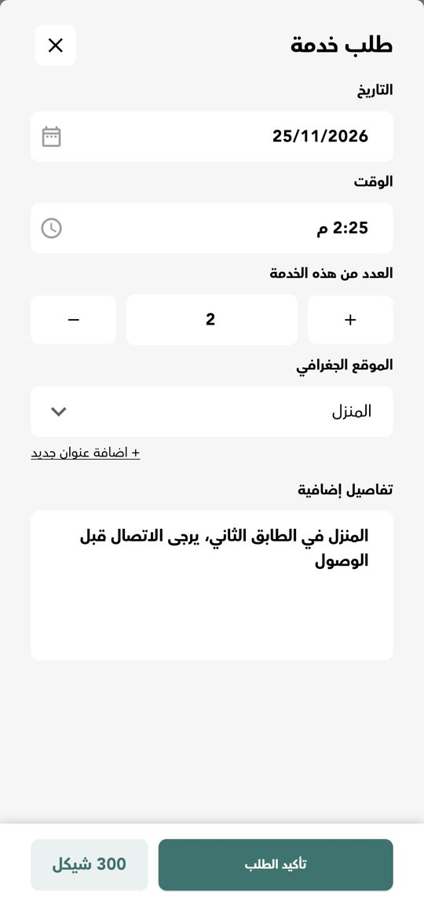
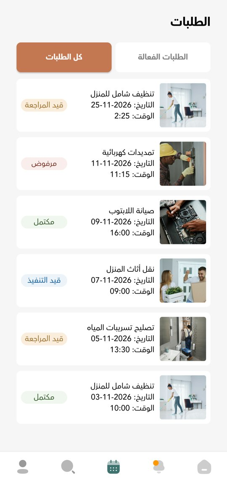

# HandyHome

Flutter app for booking home services: cleaning, electrical, plumbing, moving and maintenance.

| Home | Service | Booking | Orders |
|:---:|:---:|:---:|:---:|
|  |  |  |  |

**Stack:** Flutter · Bloc/Cubit · get_it · Dio · easy_localization · Arabic RTL

## Run

```bash
flutter pub get
flutter run
```

Runs in demo mode: `MockApiInterceptor` serves `assets/mock/` because the original API is offline.
Log in with any email and a strong password, e.g. `Demo1234!`.
